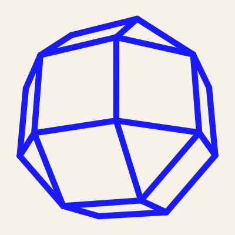
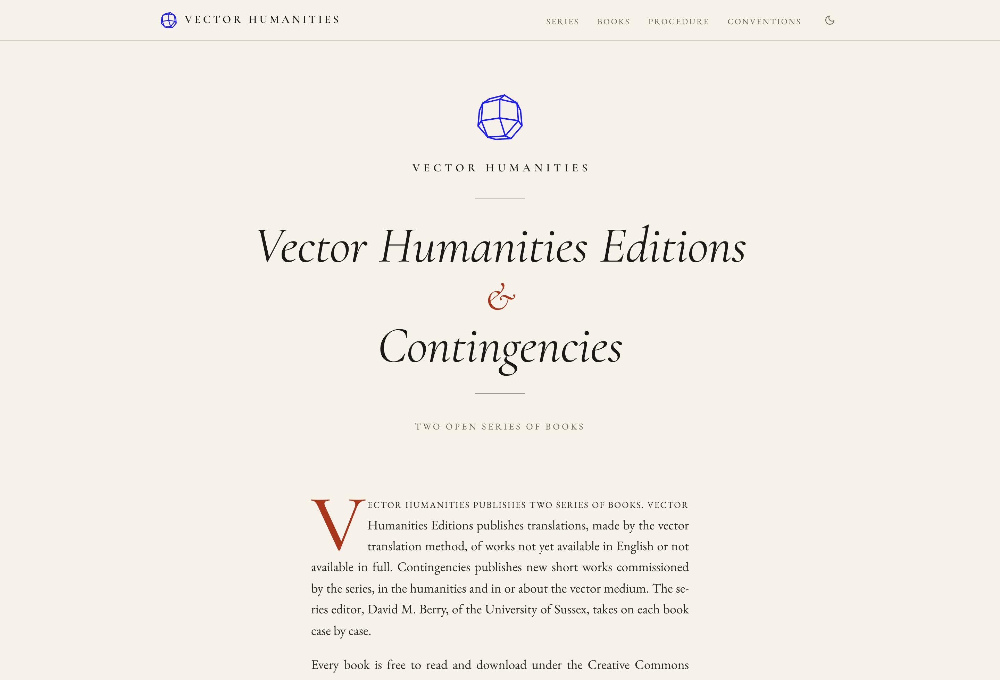
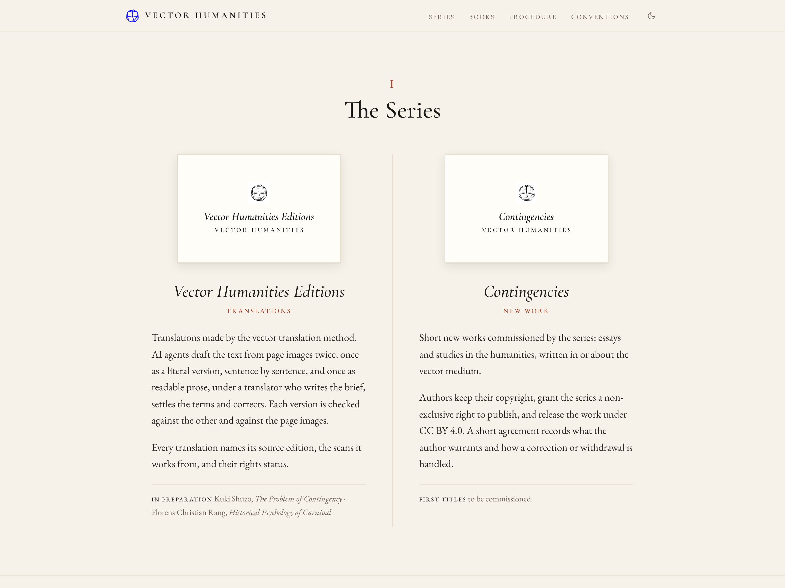
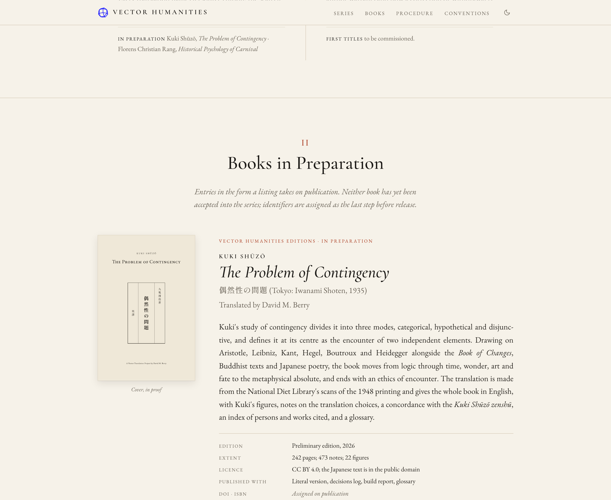
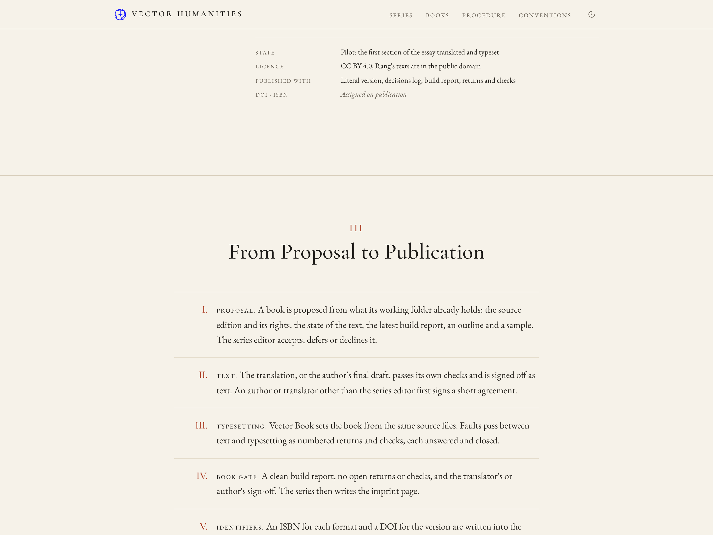
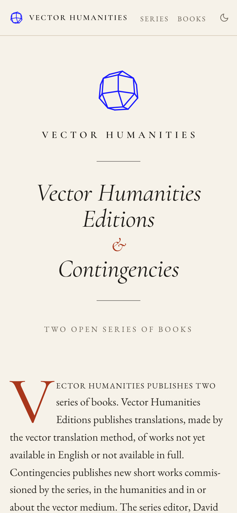

  <picture>
    <source media="(prefers-color-scheme: dark)" srcset="assets/mark-front-night.svg">
    
  </picture>

<h1 align="center"><i>Vector Humanities Editions</i> &amp; <i>Contingencies</i></h1>

Two open series of books from Vector Humanities 
<a href="https://vector-humanities.github.io/books/">vector-humanities.github.io/books</a> · series editor David M. Berry, University of Sussex

---

  <picture>
    <source media="(prefers-color-scheme: dark)" srcset="docs/img/title-dark.png">
    
  </picture>

Vector Humanities publishes two series of books. **Vector Humanities Editions** publishes translations, made by the [vector translation](https://github.com/vector-humanities/vector-translation) method, of works not yet available in English or not available in full. **Contingencies** publishes new short works commissioned by the series, in the humanities and in or about the vector medium. Each book is taken on case by case.

Every book is free to read and download under the [Creative Commons Attribution 4.0 International licence](https://creativecommons.org/licenses/by/4.0/), and is published with its workings: the decisions log, the build report from [Vector Book](https://github.com/vector-humanities/vector-book), and the records of the faults found and corrected between text and typesetting. A translation is also published with its literal version.

## The series

| Series | Publishes | Imprint page |
|---|---|---|
| *Vector Humanities Editions* | Translations by the vector translation method, each naming its source edition, the scans it works from, and their rights status | "This is a vector translation." The Translator's Note describes how AI agents were used and what the translator decided |
| *Contingencies* | New short works commissioned by the series. Authors keep their copyright, grant the series a non-exclusive right to publish, and release the work under CC BY 4.0 | How AI was used is stated in the preface |

## Books in preparation

<table>
<tr>
<td width="50%" align="center" valign="top">
  
<b>Kuki Shūzō</b> 
<i>The Problem of Contingency</i> 
偶然性の問題 (Iwanami Shoten, 1935) 
translated by David M. Berry 
Vector Humanities Editions · preliminary edition in preparation
</td>
<td width="50%" align="center" valign="top">
  
<b>Florens Christian Rang</b> 
<i>Historical Psychology of Carnival</i> 
with <i>Faith, Love and Industriousness: A Letter to Walther Rathenau</i> 
<i>Die Kreatur</i> 2 (1927/28), translated by David M. Berry 
Vector Humanities Editions · pilot
</td>
</tr>
</table>

Neither book has yet been accepted into the series. Each will receive an ISBN for each format and a DOI for each version as the last steps before release.

## From proposal to publication

1. **Proposal.** A book is proposed from what its working folder already holds: the source edition and its rights, the state of the text, the latest build report, an outline and a sample. The series editor accepts, defers or declines it.
2. **Text.** The translation, or the author's final draft, passes its own checks and is signed off as text. An author or translator other than the series editor first signs a short agreement.
3. **Typesetting.** Vector Book sets the book from the same source files. Faults pass between text and typesetting as numbered returns and checks, each answered and closed.
4. **Book gate.** A clean build report, no open returns or checks, and the translator's or author's sign-off. The series then writes the imprint page.
5. **Identifiers.** An ISBN for each format and a DOI for the version are written into the book, which is rebuilt and checked once more.
6. **Publication.** The book and its workings are published, the DOI is registered, and the book is listed on the series page. A correction is published as a new version with its own DOI.

## How the books are kept

| | |
|---|---|
| **Open access** | Every book is free to read and download under CC BY 4.0. A translation of a public-domain text leaves the original in the public domain; the licence covers the translation and its apparatus |
| **Material from elsewhere** | Material that belongs to someone else, such as an image or a long quotation, is outside the licence unless cleared, and is marked as such on the imprint page |
| **AI disclosure** | Machine drafting is identified as such, on the imprint page and in the Translator's Note or preface |
| **Workings** | Decisions on terms, readings and corrections are logged with their dates and published with the book, with its build report and its return and check files |
| **Versions** | Numbered versions, each with its own DOI, and a further DOI that resolves to the latest. Earlier versions remain available |
| **Corrections** | A reported fault is recorded in the book's return files with what was found, where, and what was changed, and is published in a new version |

## This repository

The series page, served by GitHub Pages at [vector-humanities.github.io/books](https://vector-humanities.github.io/books/). It is a single HTML page with no build step: `index.html` and `assets/`. The images in this README are in `docs/img/`.

## Related

- [Vector Humanities](https://vector-humanities.github.io/): the programme
- [Vector Translation](https://github.com/vector-humanities/vector-translation): the translation method
- [Vector Book](https://github.com/vector-humanities/vector-book): book design and typesetting
